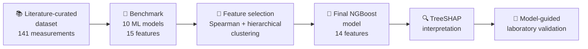

<div align="center">

# Interpretable Machine Learning to Accelerate Formulation Development

## Predicting and Optimizing Drug Loading in Chitosan Nanoparticles

[](#-how-to-cite)
[](#-how-to-cite)

[](https://www.python.org/)
[](https://scikit-learn.org/)
[](https://github.com/stanfordmlgroup/ngboost)
[](https://github.com/shap/shap)
[](LICENSE)

<br>


<br>

**Curated dataset · Python implementation · Explainable ML analyses**

[Overview](#-study-overview) •
[Key Findings](#-key-findings) •
[Workflow](#-workflow) •
[Repository](#-repository-organization) •
[Environment](#%EF%B8%8F-software-environment) •
[Citation](#-how-to-cite) •
[Authors](#-authors-and-affiliations)

</div>

---

## 📖 Study Overview

This repository accompanies the study **“Interpretable Machine Learning to Accelerate Formulation Development: Predicting and Optimizing Drug Loading in Chitosan Nanoparticles.”** It presents an explainable machine-learning workflow for predicting drug loading (DL) in chitosan-based nanoparticles and supporting data-informed formulation development.

<div align="center">

| 🧪 Measurements | 💊 Drugs | 🔗 Drug–Chitosan Pairs | 🧫 Chitosan Types | 🤖 Models Benchmarked | 📊 Final Features |
| :-: | :-: | :-: | :-: | :-: | :-: |
| **141** | **32** | **39** | **4** | **10** | **14** |

</div>

**Chitosan-based nanoparticle types covered:**
- Conventional chitosan
- Carboxymethyl chitosan
- Trimethyl chitosan
- Thiolated chitosan

Ten regression algorithms were benchmarked using **15 input features** describing polymer properties, formulation parameters, and molecular descriptors. After correlation-based feature selection (Spearman rank correlation + agglomerative hierarchical clustering), a final **14-feature Natural Gradient Boosting (NGB)** model was developed and interpreted with **TreeSHAP**.

---

## 🔑 Key Findings

The most influential predictors of drug loading, ranked by SHAP importance:

| Rank | Feature | Description |
| :--: | :------ | :---------- |
| 1 | `D/C ratio` | Drug-to-chitosan ratio |
| 2 | `PS` | Particle size |
| 3 | `Drug_MW` | Drug molecular weight |
| 4 | `Cross/C ratio` | Crosslinker-to-chitosan ratio |
| 5 | `NumHDonors` | Number of hydrogen-bond donors |

---

## 🔄 Workflow



---

## 📁 Repository Organization

```text
.
├── 📂 Models Training/                     # Training & benchmarking of 10 ML models (15 features)
├── 📂 Box Plot/                            # Box plots of model performance and prediction errors
├── 📂 Feature selection/                   # Spearman correlation & agglomerative clustering;
│                                           #   14-feature selection and final NGB model training
├── 📂 SHAP/                                # TreeSHAP: global importance, beeswarm, decision paths,
│                                           #   force plots, and t-SNE
├── 📂 Model-guided Laboratory Validation/  # Experimental validation of model-guided formulations
├── 📂 data/                                # Curated dataset used in the study
├── 📄 LICENSE
└── 📄 README.md
```

---

## ⚙️ Software Environment

All analyses were performed with the following Python environment:

<div align="center">

| Library | Version | | Library | Version |
| :------ | :-----: |-| :------ | :-----: |
| 🐍 Python | `3.9.12` | | 🌲 XGBoost | `2.1.4` |
| 🔢 NumPy | `1.26.4` | | 💡 LightGBM | `4.3.0` |
| 🐼 pandas | `2.3.3` | | 📈 NGBoost | `0.5.1` |
| 📊 Matplotlib | `3.9.0` | | 🔍 SHAP | `0.49.1` |
| 🎨 Seaborn | `0.13.2` | | 📑 openpyxl | `3.1.2` |
| 🧠 scikit-learn | `1.6.1` | | | |

</div>

<details>
<summary><b>📦 Quick install</b></summary>

<br>

```bash
pip install numpy==1.26.4 pandas==2.3.3 matplotlib==3.9.0 seaborn==0.13.2 \
            scikit-learn==1.6.1 xgboost==2.1.4 lightgbm==4.3.0 \
            ngboost==0.5.1 shap==0.49.1 openpyxl==3.1.2
```

</details>

---

## 📝 How to Cite

If you use the data, code, or methods from this repository, please cite:

> Qaribnejad A, Shiranirad S, Movahedi S, Aftabi P, Varshochian R, Barzegar Z.
> **Interpretable machine learning to accelerate formulation development: Predicting and optimizing drug loading in chitosan nanoparticles.**
> *Journal of Pharmaceutical Sciences*. 2026:104628.

<details>
<summary><b>📋 BibTeX</b></summary>

<br>

```bibtex
@article{QARIBNEJAD2026104628,
title = {Interpretable machine learning to accelerate formulation development: Predicting and optimizing drug loading in chitosan nanoparticles},
journal = {Journal of Pharmaceutical Sciences},
pages = {104628},
year = {2026},
issn = {0022-3549},
doi = {https://doi.org/10.1016/j.xphs.2026.104628},
url = {https://www.sciencedirect.com/science/article/pii/S0022354926004764},
author = {Amirsajad Qaribnejad and Saba Shiranirad and Sara Movahedi and Parnia Aftabi and Reyhaneh Varshochian and Zeynab Barzegar},
keywords = {Machine learning, Chitosan nanoparticles, Drug loading, Artificial intelligence, Drug delivery},
abstract = {Machine learning (ML) has the potential to revolutionize drug formulation development by replacing slow, labor-intensive trial and error with predictive optimization. Chitosan nanoparticles (CsNPs) are an important class of nanocarriers, yet achieving high drug loading (DL) remains challenging due to complex, interdependent formulation and molecular factors. Developing a model to predict DL could therefore offer a practical solution. A dataset of CsNPs formulations, including various small-molecule drugs and chitosan derivatives, was collected. Then, input features representing chitosan properties, formulation parameters, and drug molecular descriptors were selected. Multiple ML models including linear, kernel-based, tree-based, and boosting algorithms, were trained and evaluated using nested cross-validation. Redundant features were reduced by agglomerative hierarchical clustering. Feature importance and interpretability were assessed with SHAP. Finally, SHAP-derived explanations were embedded using t-SNE to produce a low-dimensional map identifying formulation clusters associated with high and low DL. For experimental validation, model-guided formulations containing hydrophilic and hydrophobic drugs were prepared and measured DL values were compared with model predictions using Bland-Altman. Natural Gradient Boosting (NGB) produced the lowest mean absolute error (MAE) for DL prediction, equal to 5.14. SHAP analysis indicated that drug-to-chitosan ratio, particle size, and drug molecular weight were the most influential predictors. The SHAP-t-SNE map associated high DL with higher drug-to-chitosan ratios, greater chitosan deacetylation, and increased hydrogen-bond donors. Experimental validation using Bland-Altman showed relative equivalence between measured and predicted DL values, confirming model reliability. The interpretable ML pipeline therefore accurately predicts DL and provides experimentally grounded guidance to accelerate formulation design.}
}
```

</details>

---

## 👥 Authors and Affiliations

<div align="center">

**Amirsajad Qaribnejad** · **Saba Shiranirad** · **Sara Movahedi** · **Parnia Aftabi** · **Reyhaneh Varshochian** · **Zeynab Barzegar**

</div>

- Department of Pharmaceutics and Pharmaceutical Nanotechnology, School of Pharmacy, Shahid Beheshti University of Medical Sciences, Tehran, Iran
- Department of Artificial Intelligence in Medicine, Advanced Technologies in Medicine, Iran University of Medical Sciences, Tehran, Iran

---

## 📄 License

This repository is distributed under the **MIT License**. See the [LICENSE](LICENSE) file for details.

<div align="center">

<br>

⭐ *If you find this work useful, please consider starring the repository!* ⭐

</div>
